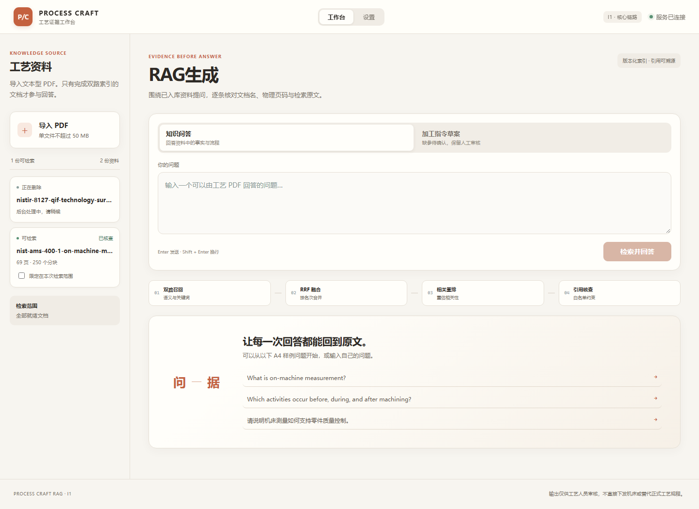
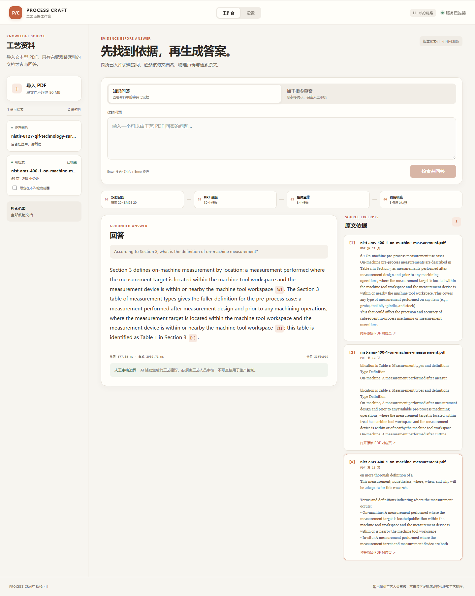
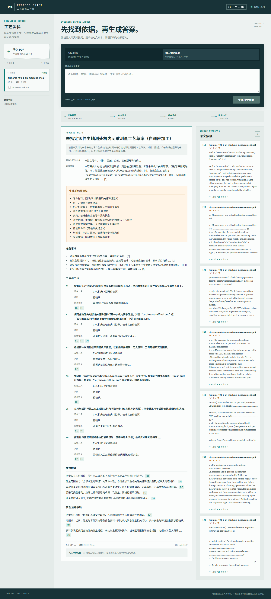

# 第一次迭代（I1）汇报

- **周期**：2026-11-09—2026-11-22
- **主题**：单文档 RAG 核心链路与最小工作台
- **结论**：**工程链路通过，带质量改进项准出**
- **功能基线**：[main 合并提交 e5a99d4](https://github.com/SWAlbert-0/Process-craft-rag/commit/e5a99d440cda00973e08fe1c08a26c14452766d7)

> 本轮使用真实 PDF、Qdrant 和模型 API 跑通了从文档入库到带引用回答的完整链路。以下质量结果属于单文档、小样本开发核查，不代表最终工艺质量达标。

## 1. 本轮交付

核心流程：

```text
PDF 解析分块 → 稠密/BM25 双路索引 → RRF 融合 → 重排序
→ DeepSeek 生成 → 引用校验 → 原文页码定位
```

| 方向 | 已完成内容 |
| --- | --- |
| 文档处理 | PDF 上传、解析、分块、状态查询和原文下载；失败记录可重试或删除 |
| 检索生成 | Qdrant + BM25 + RRF + 百炼重排；支持知识问答和加工指令草案 |
| 引用溯源 | 展示文档名、物理页码和原文快照，可打开 PDF 对应页 |
| Web 工作台 | 现代化桌面/移动页面、检索诊断、引用查看和模型设置 |
| 部署与评估 | Docker Compose、SQLite/Alembic、固定 8 题及原始评估证据 |

多文档版本管理、多轮对话、流式输出、OCR 和批量评估页面留待后续迭代。

## 2. 核心界面

### 工作台

资料状态、提问区、处理链路和检索范围集中展示。A4 样例已完成 **69 页、250 个分块**的入库。



### 带引用的知识问答

系统实际执行双路召回、融合和重排。本次复验返回 1 条原文依据，可核对页码并跳转到 PDF。



### 加工指令草案

在材料、图纸、公差和设备型号未知时，系统将其标为待确认。本次复验生成 5 个步骤和 6 条引用，并保留人工审核提示。



其他实测截图：[模型设置](https://raw.githubusercontent.com/SWAlbert-0/Process-craft-rag/9255c606093fbf4f67ddc9a4638b7f8b42ebcd68/docs/评估记录/I1/界面-设置.png) · [失败文档操作](https://raw.githubusercontent.com/SWAlbert-0/Process-craft-rag/9255c606093fbf4f67ddc9a4638b7f8b42ebcd68/docs/评估记录/I1/界面-失败操作.png) · [移动工作台](https://raw.githubusercontent.com/SWAlbert-0/Process-craft-rag/9255c606093fbf4f67ddc9a4638b7f8b42ebcd68/docs/评估记录/I1/界面-移动.png)

## 3. 验收结果

### 工程验证

| 检查项 | 结果 |
| --- | --- |
| 索引一致性 | SQLite、Qdrant、BM25 的 250 个 chunk ID 完全一致 |
| 后端检查 | Ruff 通过，**26 项自动化测试通过** |
| 前端检查 | 生产构建通过，依赖审计为 0 个已知漏洞 |
| Docker 与模型 | 服务健康检查为 `ready`；DeepSeek、嵌入和重排真实连接成功 |
| 浏览器操作 | 问答、草案、失败重试/删除通过；移动端无横向溢出 |

### 冻结 8 题质量基线

| 指标 | 结果 |
| --- | ---: |
| 有效回答 | **5/8（62.5%）** |
| 引用可核查率 | **18/18（100%）** |
| 正确拒答 | **1/1** |
| 无依据关键工艺参数 | **0/8** |
| 严重失败 | **0** |

有效回答率仍低于最终建议目标 80%。评分由开发阶段对照原文完成，**不是独立工艺人员评审**；界面复验的额外交互不计入冻结 8 题指标。

## 4. 当前不足

1. **多要点检索不完整**：部分回答遗漏关键收益、限制或校准检查。
2. **引用精确性不足**：系统能保证来源可定位，但不能自动证明每条引用完整支持对应句子。
3. **解析与评估仍有限**：复杂表格、扫描件尚未处理；独立人工评估和快照向量复用仍待完成。

## 5. 下一步（I2）

- 实现多文档快照复用、重建、删除、重启恢复和版本切换。
- 保留本轮 8 题及失败样本，扩展为 A1/A4/A2 共 30 题的评估集。
- 重点改进多要点召回、逐字段引用检查，并补充独立人工复核。

## 证据资料

[I1 验收报告](https://github.com/SWAlbert-0/Process-craft-rag/blob/9255c606093fbf4f67ddc9a4638b7f8b42ebcd68/docs/评估记录/I1/验收报告.md) · [冻结题集](https://github.com/SWAlbert-0/Process-craft-rag/blob/9255c606093fbf4f67ddc9a4638b7f8b42ebcd68/docs/评估记录/I1/冒烟题集.json) · [原始输出](https://github.com/SWAlbert-0/Process-craft-rag/blob/9255c606093fbf4f67ddc9a4638b7f8b42ebcd68/docs/评估记录/I1/原始输出.json)
